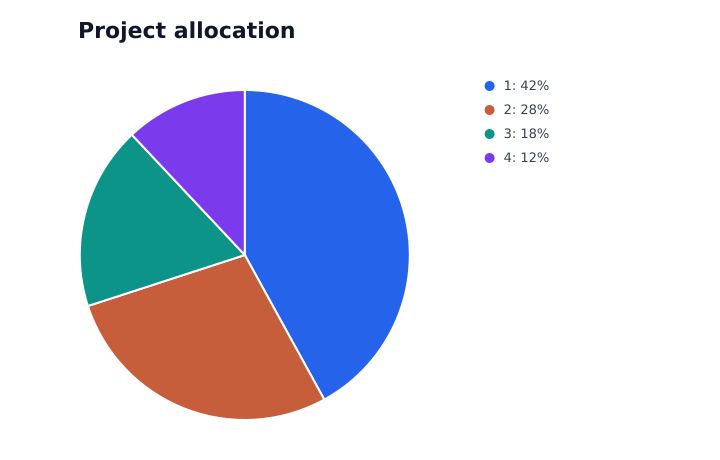
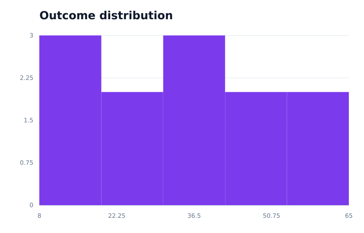

# Vizx

Static plotting, written entirely in Arx. Vizx provides bar, line, scatter,
pie, and histogram charts with a small Plotly Express inspired API. The renderer
generates standalone SVG: no browser, JavaScript, Plotly, Matplotlib, or custom native
extension is needed.


## Quick start

Use Arx **1.25.0**, the latest published release when this project was
bootstrapped. Install Clang and the Arx tools, or use `conda.yaml`:

```sh
python -m pip install -r requirements-dev.txt
```

Save this as `examples/quickstart.x` inside this repository:

````text
```
title: My first Vizx plot
```
import line from vizx.express
import Figure from vizx.figure
import from_series from vizx.data.series

fn main() -> i32:
  var data: dataframe[x: f64, y: f64] = dataframe({
    x: [1.0, 2.0, 3.0],
    y: [4.0, 2.0, 7.0],
  })
  var fig: Figure = line(x=from_series(data.x), y=from_series(data.y), title="My first plot")
  fig.write_image("build/first.svg")
  return 0
````

```sh
mkdir -p build
arx examples/quickstart.x --output-file build/quickstart --run
```

DataFrame columns and standalone `series[f64]` values use the shared
`from_series` adapter. It creates an owned numeric snapshot in row order;
all five chart types use the same input representation. Existing `list[f64]`
inputs work directly. For `list[i32]` and `range` results, use
`from_i32_list` from `vizx.data.lists`, for example
`histogram(from_i32_list(range(0, 20)), nbins=5)`.
[`examples/ranges.x`](examples/ranges.x) is a complete example of this path
and does not import the Arrow-backed Series adapter.

Arx 1.25.0 cannot materialize an owned list from a literal or index arbitrary
runtime-shaped tensor parameters. Collection adapters are explicit until the
compiler provides a shared typed sequence protocol. No arbitrary collection
is implicitly coerced. Integer widening is exact for all i32 values; i64/u64
and multidimensional inputs are not accepted by these adapters.

The Series adapter limits snapshots to one million points by default; callers
can set `max_points`. Nullable f64 columns use `from_nullable_series`, which
rejects nulls rather than removing rows and misaligning x/y coordinates.
Using Series requires the compiler's bundled Arrow runtime and a C++ toolchain.
The plotting implementation and adapters remain entirely Arx.

For the complete gallery and compiled tests:

```sh
makim tests.gallery
makim tests.ci
arxpm pack
```

The package follows SciArx's `src/`, ArxPM manifest, compiled `.x` tests, Conda,
and Makim structure. `arxpm pack` packages the Arx source for other projects;
it does not translate the plotting implementation into Python.
An external consumer must declare `vizx` under `project.dependencies` in its
own manifest so Arx discovers the installed source. See
[`examples/consumer/.arxproject.toml`](examples/consumer/.arxproject.toml).

## Extending Vizx

Each chart module owns its geometry. `data/` owns collection adaptation,
`bins.x` owns uniform histogram counting, and `scales.x` owns data
validation and domains; `axes.x` owns ticks and grids; `svg.x` owns primitives;
`numbers.x` owns decimal formatting; `figure.x` owns the final document and I/O.
`express.x` is an explicit export facade.

Add a chart module using these shared parts, export it from `express.x`, and
add focused tests and an example. Existing chart modules need no edits. There
is no central switch over chart types and no compiler/runtime modification.

## Initial scope

- One series per figure; numeric `list[f64]` inputs. Bars treat numeric x
  values as category labels in input order. Lines connect input order without
  sorting. Scatter plots draw individual markers.
- Empty, mismatched, nonfinite, and out-of-range data raise `ValueError`.
  Values are limited to magnitude `1e150` to keep scale arithmetic finite.
  Constant domains expand automatically. Bars include zero and support
  negative values. Above 12 bars, category labels are omitted to limit overlap.
- Pies accept 1..12 nonnegative weights with a positive total and use numeric
  slice labels. Zero-weight slices retain their legend entry; a single positive
  slice renders as a full circle. Small figures must fit the legend.
- Histograms accept 1..128 uniform bins, count every sample, and include the
  maximum in the final bin. Other bins include their left edge and exclude
  their right edge. Bin edges that collapse at floating-point precision are
  rejected. Constant samples receive an expanded domain. Counting currently
  costs O(points × bins).
- SVG is the only output format, regardless of filename extension. PNG/PDF,
  multiple traces, string categories, and interactive charts are not
  implemented. Committed PNGs are review previews of the SVG gallery.
- Titles use XML CDATA, so ordinary Unicode, `&`, and `<` work without entity
  escaping. Titles must not contain `]]>` or XML control characters. Arx
  1.25.0 does not expose the string traversal needed to validate or escape
  those sequences; this restriction applies to trusted local titles.
- SVG coordinates and ticks are rounded to three fractional digits, using
  scientific notation for very small or large values. Repeated text assembly
  favors small plots; large-data optimization is future work.
- Export overwrites its destination. Files close even after a write failure;
  writes are not atomic and parent directories must already exist.




