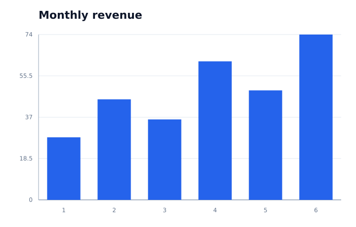
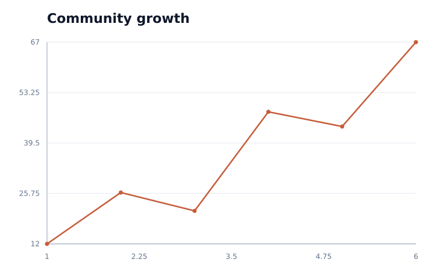
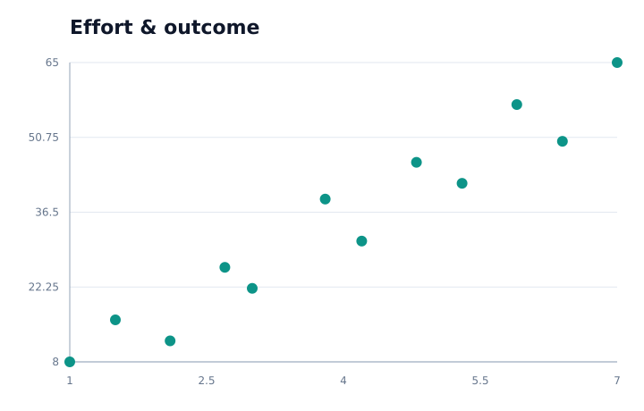

# Vizx

Static plotting, written entirely in Arx. Vizx starts with bar, line, and
scatter charts and a small Plotly Express inspired API. The renderer generates
standalone SVG: no browser, JavaScript, Plotly, Matplotlib, or custom native
extension is needed.



## Quick start

Use Arx **1.25.0**, the latest published release when this project was
bootstrapped. Install Clang and the Arx tools, or use `conda.yaml`:

```sh
python -m pip install -r requirements-dev.txt
```

Save this as `examples/quickstart.x` inside this repository:

````text
```
title: My first Vizx plot
```
import line from vizx.express
import Figure from vizx.figure

fn main() -> i32:
  var x: list[f64]
  var y: list[f64]
  for value in [1.0, 2.0, 3.0]:
    x.append(value)
  for value in [4.0, 2.0, 7.0]:
    y.append(value)
  var fig: Figure = line(x=x, y=y, title="My first plot")
  fig.write_image("build/first.svg")
  return 0
````

```sh
mkdir -p build
arx examples/quickstart.x --output-file build/quickstart --run
```

Arx 1.25.0 requires dynamic lists at function boundaries. A typed empty list
and `append` provide that ownership; list literals can be iterated as above.

For the complete gallery and compiled tests:

```sh
makim tests.gallery
makim tests.ci
arxpm pack
```

The package follows SciArx's `src/`, ArxPM manifest, compiled `.x` tests, Conda,
and Makim structure. `arxpm pack` packages the Arx source for other projects;
it does not translate the plotting implementation into Python.
An external consumer must declare `vizx` under `project.dependencies` in its
own manifest so Arx discovers the installed source. See
[`examples/consumer/.arxproject.toml`](examples/consumer/.arxproject.toml).

## Extending Vizx

`bar.x`, `line.x`, and `scatter.x` own their geometry. `scales.x` owns data
validation and domains; `axes.x` owns ticks and grids; `svg.x` owns primitives;
`numbers.x` owns decimal formatting; `figure.x` owns the final document and I/O.
`express.x` is an explicit export facade.

Add a chart module using these shared parts, export it from `express.x`, and
add focused tests and an example. Existing chart modules need no edits. There
is no central switch over chart types and no compiler/runtime modification.

## Initial scope

- One series per figure; numeric `list[f64]` inputs. Bars treat numeric x
  values as category labels in input order. Lines connect input order without
  sorting. Scatter plots draw individual markers.
- Empty, mismatched, nonfinite, and out-of-range data raise `ValueError`.
  Values are limited to magnitude `1e150` to keep scale arithmetic finite.
  Constant domains expand automatically. Bars include zero and support
  negative values. Above 12 bars, category labels are omitted to limit overlap.
- SVG is the only output format, regardless of filename extension. PNG/PDF,
  legends, multiple traces, string categories, and interactive charts are not
  implemented. Committed PNGs are review previews of the SVG gallery.
- Titles use XML CDATA, so ordinary Unicode, `&`, and `<` work without entity
  escaping. Titles must not contain `]]>` or XML control characters. Arx
  1.25.0 does not expose the string traversal needed to validate or escape
  those sequences; this restriction applies to trusted local titles.
- SVG coordinates and ticks are rounded to three fractional digits, using
  scientific notation for very small or large values. Repeated text assembly
  favors small plots; large-data optimization is future work.
- Export overwrites its destination. Files close even after a write failure;
  writes are not atomic and parent directories must already exist.



